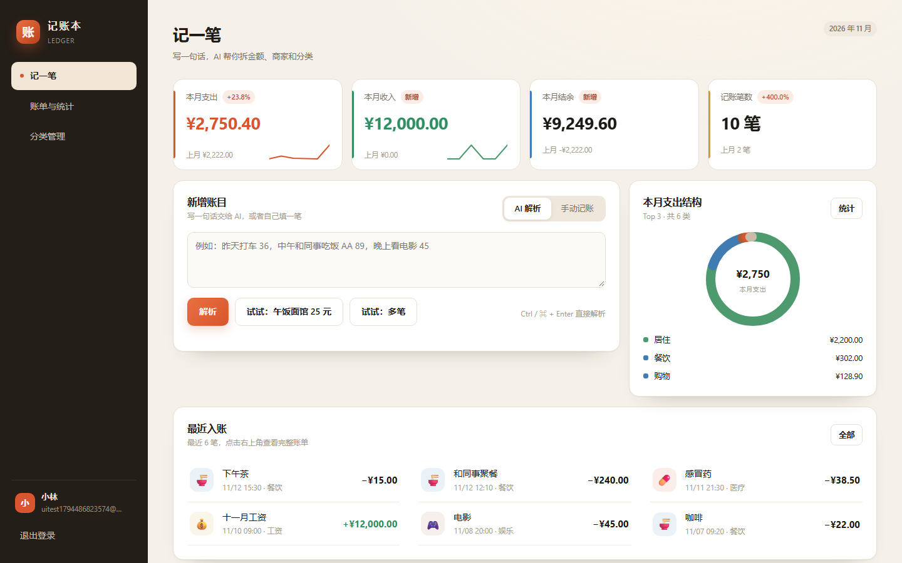
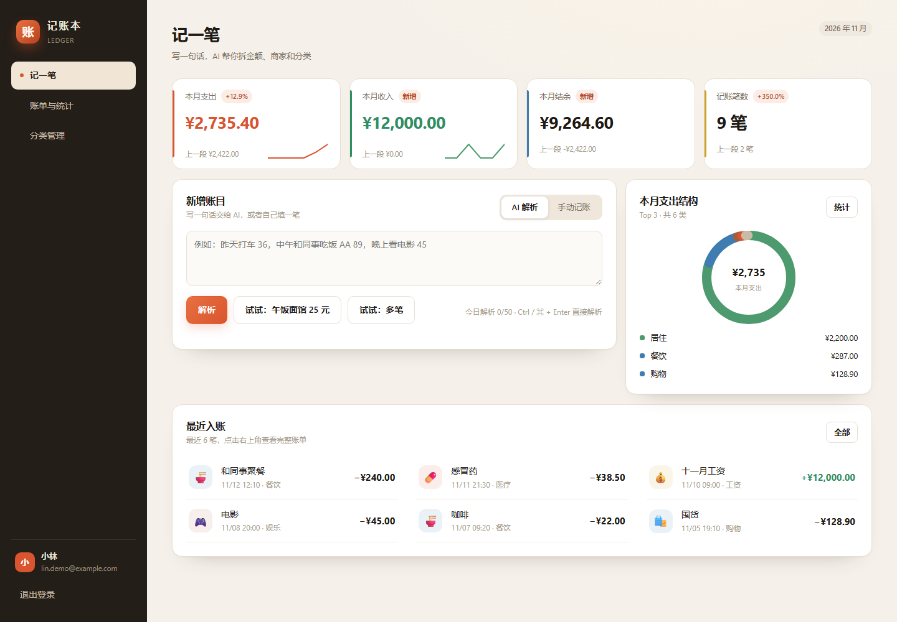
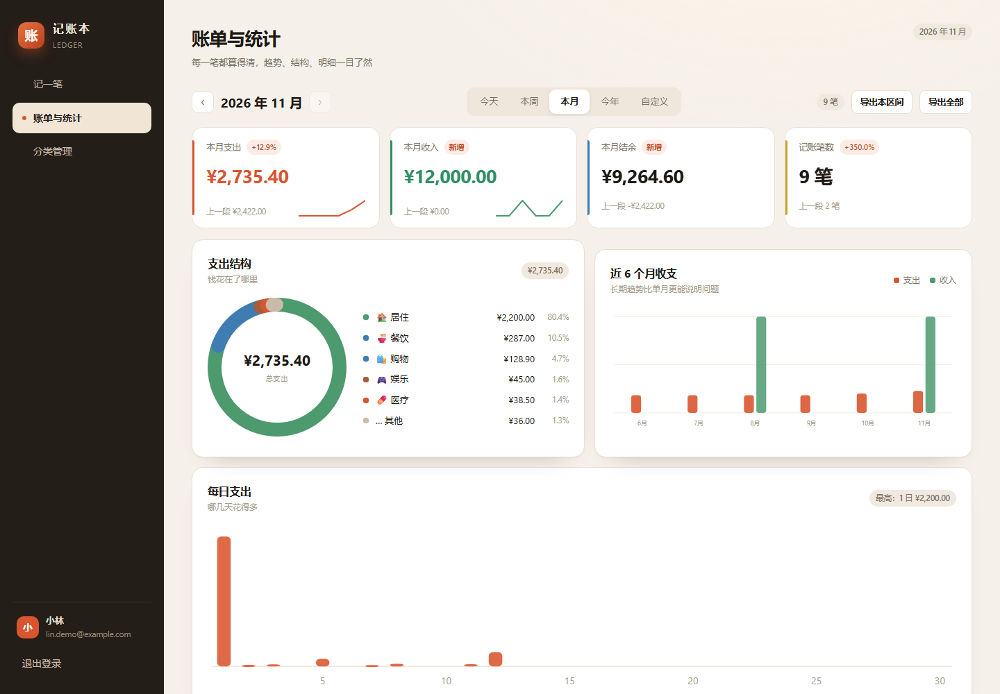
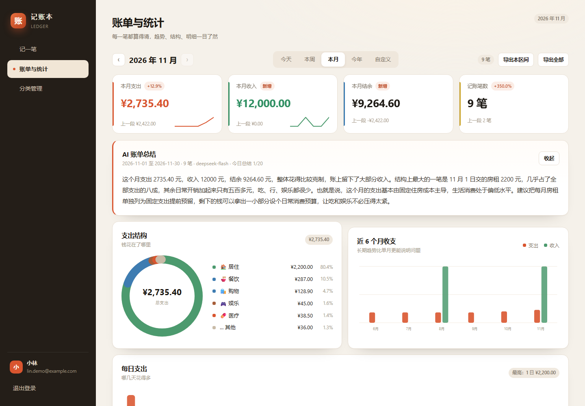
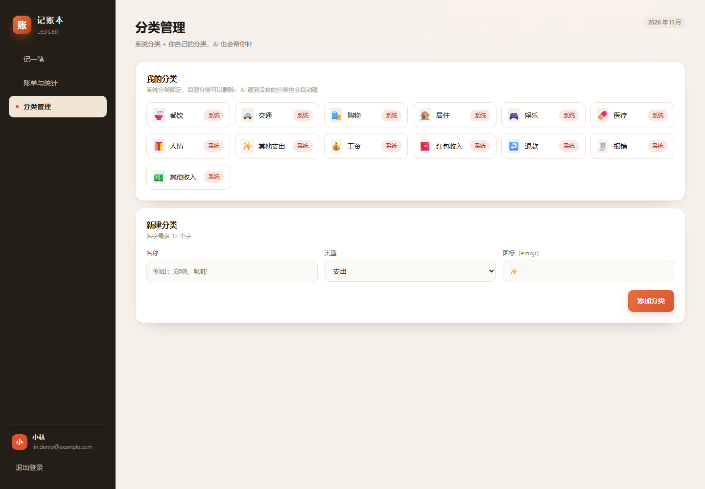
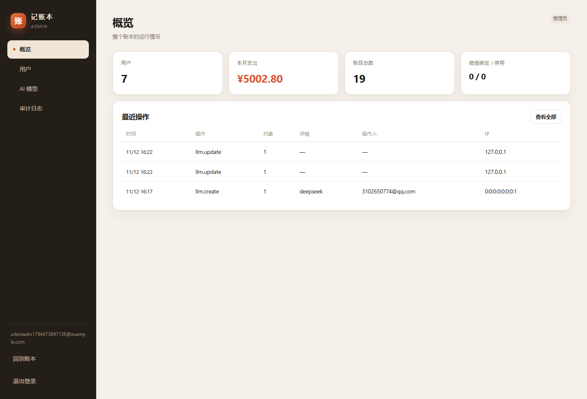
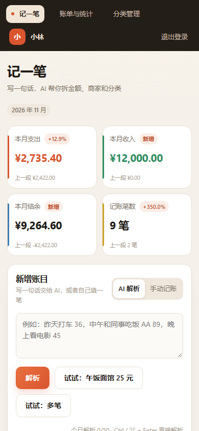
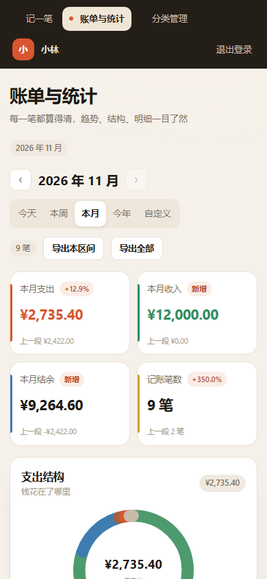

# 记账本 v0.4.0 — 一句话记账（MySQL）

一句话记账的全栈小项目：**微信小程序** + **网页端** + **Spring Boot 后端**。
写下「午饭面馆 25 元」，AI 拆出金额、商家、分类、日期；也可以完全不用 AI 手动记。
分类不够用时 AI 会自己新建，用户也能自己建。

```
miniprogram/   小程序（记一笔 / 手动记 / 账单）
server/        Spring Boot 3.3.4 + MySQL 8 + Flyway，另带网页端
docs/          API、部署、MySQL 迁移文档
```

## 功能

- **AI 解析**：一句话可拆多笔，支持「AA / 垫付 / 昨天」这类说法，给出置信度
- **AI 建分类**：模型建议的新分类会自动落库并返回给客户端（`createdCategories`）
- **手动记账**：不经过模型，金额 / 分类 / 备注 / 日期直接入账（`source=manual`）
- **分类管理**：系统 13 个分类带 emoji，自建分类可增删，同名自动复用
- **账单**：今天 / 本周 / 本月 / 今年 / 自定义区间；收支、结余、分类占比、按天分组
- **改账单**：金额、类型、分类、时间、备注、商家随时改（`PATCH /api/transactions/{id}`）
- **搜索**：备注 / 商家 / 分类名模糊搜，和区间、类型叠加
- **AI 总结**：按区间生成中文复盘（结构、异常、建议），有「解析 50 次/天、总结 20 次/天」上限
- **离线补推**：后端连不上时先记在本地，恢复后自动或手动一起推上去
- **统计与图表**：`GET /api/report` 给出环比、分类结构、每日收支、近 6 个月趋势、商家 Top 6，
  网页用纯 SVG 画环形图 / 柱状图 / 迷你走势（不引第三方图表库）
- **一键导出**：`GET /api/transactions/export` 按区间或全部导出 CSV（Excel 可直接打开）
- **管理后台**：用户与角色、模型配置与连通性测试、审计日志
- **微信登录**：`code2session` 绑定/解绑，账号停用或登出后旧令牌立即失效

## 版本

| 组件 | 版本 |
|---|---|
| 应用 | **0.4.0** |
| Java | 17 LTS |
| Spring Boot | 3.3.4 |
| MySQL | 8.0+（推荐 8.4） |
| Flyway | Boot 管理（`flyway-mysql`） |
| jjwt | 0.12.6 |

## 跑起来

```bash
cd server
cp .env.example .env
openssl rand -hex 32   # JWT_SECRET
openssl rand -hex 32   # APP_SECRET
# 按需改 .env 里的 SPRING_DATASOURCE_*

docker compose up -d mysql
set -a && source .env && set +a
mvn spring-boot:run
```

不装 Docker 也行：本机 MySQL 建好 `ledger` 库（`utf8mb4`），把连接串写进 `server/.env`，
`mvn spring-boot:run` 会自动跑 Flyway 迁移（V1 → V5）。

IDE 里直接跑：工作目录设成 `server/` 或项目根都行（会读 `server/.env`）。
缺 `APP_SECRET` / `JWT_SECRET` 会直接告诉你缺什么，不会抛占位符异常。
**数据库口令没有默认值**，`SPRING_DATASOURCE_PASSWORD` 必须显式提供。

打开 `http://localhost:3000/login.html` 注册，**库空时第一个账号自动成为管理员**。
然后到 `/admin.html` → AI 模型 → 添加一个配置并点「测试」，记账功能才可用。

## 页面

| 地址 | 说明 |
|---|---|
| `/` | 落地页 |
| `/login.html` | 登录 / 注册 / 忘记密码 |
| `/app.html` | 账本：记一笔（AI / 手动）、账单与统计、分类管理 |
| `/admin.html` | 后台：概览、用户、AI 模型、审计日志 |

小程序三个 tab：**记一笔**（AI 解析）、**手动记**（分类宫格）、**账单**（日/周/月/年/自定义 + 搜索 + 点按改单）。
`miniprogram/utils/config.js` 的 `DEV` 默认 `http://127.0.0.1:3000`，开发者工具模拟器可直接用
（先在「详情 → 本地设置」勾选「不校验合法域名…」）；真机调试改成电脑的内网 IP（本机当前
`192.168.10.103`），并放行防火墙 3000 端口。正式版走 `PROD`。

### 界面预览

| 落地页 | 登录 |
|---|---|
|  |  |

| 记一笔（KPI + 结构图） | 账单与统计（环形图 / 趋势 / 每日） |
|---|---|
|  |  |

| AI 区间总结 | 分类管理 |
|---|---|
|  |  |

| 后台 | 移动端（390px） |
|---|---|
|  |  |

| 移动端账单 |
|---|
|  |

账单页右上角可切换区间、搜索、导出 CSV；每行 ✎ 改金额/分类/时间/备注/商家，
「AI 总结这段」会按当前区间生成一段中文复盘。

## 环境变量

| 变量 | 必填 | 说明 |
|---|---|---|
| `JWT_SECRET` | 是 | ≥32 字节，HS256 签名密钥 |
| `APP_SECRET` | 是 | ≥32 字符，用于 AES-256-GCM 加密模型 API Key |
| `SPRING_DATASOURCE_URL` | 否 | 默认本机 `ledger` 库，时区参数见下 |
| `SPRING_DATASOURCE_USERNAME` / `_PASSWORD` | 是 | 数据库账号；口令无默认值 |
| `APP_ADMIN_EMAIL` | 否 | 指定该邮箱注册时直接成为管理员 |
| `APP_SIGNUP_ENABLED` | 否 | 默认 `true` |
| `APP_TRUST_PROXY` | 否 | 反代后设为 `true`，限流与审计才拿得到真实 IP |
| `AI_PARSE_DAILY` | 否 | 每人每天 AI 解析次数，默认 50 |
| `AI_SUMMARY_DAILY` | 否 | 每人每天 AI 总结次数，默认 20 |
| `WX_APPID` / `WX_SECRET` | 微信登录必填 | 小程序凭据 |
| `PORT` | 否 | 默认 3000 |

MySQL 连接串的时区请用固定偏移，不要写 `Asia/Shanghai`（很多镜像没有时区表）：

```
jdbc:mysql://localhost:3306/ledger?useUnicode=true&characterEncoding=utf8&connectionTimeZone=%2B08:00&forceConnectionTimeZoneToSession=true&allowPublicKeyRetrieval=true&useSSL=false
```

## 数据库迁移

| 版本 | 内容 |
|---|---|
| V1 | 初始表结构（users / transactions / categories / llm_configs / audit_logs …） |
| V2 | `users.token_version`，用于令牌吊销 |
| V3 | `parse_feedback` 补 `ON DELETE CASCADE` 外键 |
| V4 | 自定义分类：`categories.user_id / icon / sort`，系统分类补 emoji |
| V5 | `ai_usage`：AI 解析 / 总结的按天配额 |

新增迁移放 `V6__xxx.sql`，**不要改已应用过的文件**。

## 测试

```bash
cd server && mvn test     # 单元测试，不需要数据库
```

## 已知限制

- 密码重置链接只打印在服务端日志里，没有接 SMTP
- 限流是单进程内存桶，多实例部署时按实例计数
- AI 解析依赖后台配置的 OpenAI 兼容接口；没有可用配置时返回 503 `NO_LLM_CONFIG`
- AI 次数按「用户 + 自然日」在库里计数，跨进程一致；配额用完后 429 `AI_QUOTA_EXCEEDED`
- 离线队列存在浏览器 / 小程序本地，换设备不会带走；同一台设备恢复网络后自动补推

更多细节：`docs/API.md`（接口契约）、`docs/DEPLOY.md`（部署）、`docs/MYSQL.md`（MySQL 迁移）。
